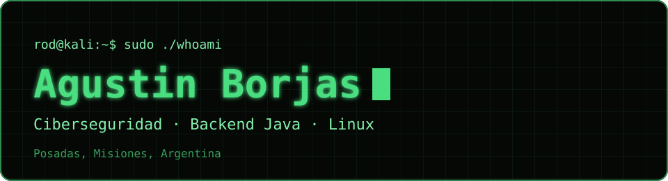

<a href="https://github.com/rod-br">
  <picture>
    <source media="(prefers-color-scheme: dark)" srcset="assets/banner-dark.svg">
    <source media="(prefers-color-scheme: light)" srcset="assets/banner-light.svg">
    
  </picture>
</a>

 

---

## `$ whoami`

  <picture>
    <source media="(prefers-color-scheme: dark)" srcset="assets/whoami-dark.svg">
    <source media="(prefers-color-scheme: light)" srcset="assets/whoami-light.svg">
    
  </picture>

---

## `$ cat stack.yaml`

<table border="1" cellpadding="14" bgcolor="#050805">
  <thead>
    <tr><th colspan="2" align="left"><code>rod-br:~$ cat stack.yaml</code></th></tr>
  </thead>
  <tbody>
    <tr>
      <td width="50%" valign="top"><code>├─ ☕ backend:</code>  
         
        <code>Java · Spring Boot · Spring Data JPA · Go · REST APIs</code>
      </td>
      <td width="50%" valign="top"><code>├─ ▣ datos:</code>  
         
        <code>SQL · JPA / Hibernate</code>
      </td>
    </tr>
    <tr>
      <td valign="top"><code>├─ ⚙ infraestructura:</code>  
         
        <code>Linux · Docker · Bash</code>
      </td>
      <td valign="top"><code>├─ ⌁ seguridad:</code>  
        
         
        <code>Spring Security · JWT · Hashing · Hardening</code>
      </td>
    </tr>
    <tr>
      <td colspan="2" valign="top"><code>╰─ ◧ frontend:</code>  
         
        <code>HTML · CSS</code>
      </td>
    </tr>
  </tbody>
  <tfoot>
    <tr><td colspan="2"><code>status: aprendiendo&nbsp;&nbsp;·&nbsp;&nbsp;environment: development</code></td></tr>
  </tfoot>
</table>

---

## `$ ./skills --radar`

  <picture>
    <source media="(prefers-color-scheme: dark)" srcset="assets/radar-dark.svg">
    <source media="(prefers-color-scheme: light)" srcset="assets/radar-light.svg">
    
  </picture>&nbsp;
  <picture>
    <source media="(prefers-color-scheme: dark)" srcset="assets/radar-langs-dark.svg">
    <source media="(prefers-color-scheme: light)" srcset="assets/radar-langs-light.svg">
    
  </picture>

---

## `$ ls proyectos/`

<table border="1" cellpadding="14" bgcolor="#050805">
  <thead>
    <tr><th colspan="2" align="left"><code>rod-br:~$ ls proyectos/</code></th></tr>
  </thead>
  <tbody>
    <tr>
      <td colspan="2" valign="top"><code>├─ ❯ LogiPack/</code>  
         
        <code>Java Swing · Spring Boot · SQL · React · Vite · HTML · VeraCrypt · DPAPI</code>
      </td>
    </tr>
    <tr>
      <td width="50%" valign="top"><code>├─ ❯ VentaFacil/</code> <code>privado</code>  
         
        <code>Sistema de ventas ERP simple y liviano · Go + SQLite + HTML + CSS</code>
      </td>
      <td width="50%" valign="top"><code>╰─ ❯</code> <a href="https://github.com/rod-br/ssh-manager"><code>ssh-manager/</code></a>  
         
        <code>Gestor de conexiones SSH en un solo script de Bash · sin dependencias</code>
      </td>
    </tr>
  </tbody>
</table>

---

## `$ connect --socials`

&nbsp;&nbsp;
&nbsp;&nbsp;

 

Hecho con ☕ desde Posadas, Misiones, Argentina · @rod-br

